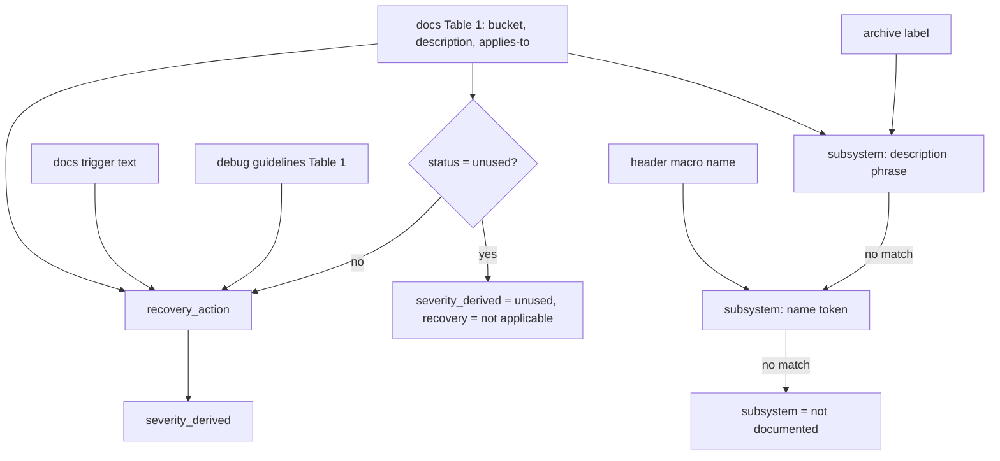

# CLASSIFICATION — scheme and decision rules

Principle: a value is assigned only when a source supports it. Otherwise the value is `not documented`. The three fields are separate; each has a `*_basis` or `recovery_basis` column so a reader can see why.

Walkthrough: documentation text (docs bucket, trigger text, debug guidelines) decides `recovery_action`. `severity_derived` is then derived from that action. Unused codes short-circuit to `unused`. `subsystem` is decided separately from description phrases first, then name tokens. No connection in this diagram is inferred; all follow `scripts/build.py`.

## 1. status
- `unused`: docs description is "Unused" and all four applies-to flags are NO; or the header macro name contains UNUSED; or (code 108) the description and trigger text say Unused although the flags say applicable, recorded in `notes`.
- `unused in catalogue; action in debug guidelines`: codes 61 and 123. The docs catalogue lists them as unused, the debug guidelines give a reset action. Their severity and recovery values come from the debug guidelines.
- `reserved`: header macro name contains RESERVED and the docs do not list the code.
- `active`: documented and not unused. `active (header only)`: header name only, nothing documented.
- Counts: active 110, unused 61, active (header only) 12, unused in catalogue; action in debug guidelines 2, reserved 1.

## 2. recovery_action (documented action)
Order of evidence: (1) explicit statements in docs trigger text or Table 3 workflows where they override the bucket (codes 45, 48, 74, 154, 163-165, 168, 144-150); (2) docs immediate-action bucket mapped by the table below; (3) debug-guidelines action when the docs have no usable bucket (codes 61, 123 only); otherwise `not documented`.

| docs bucket | recovery_action |
|---|---|
| IGNORE | none needed |
| RESTART_APP | restart application |
| RESTART_VM | restart VM |
| RESET_GPU | reset GPU |
| RESTART_BM | restart host (bare metal) |
| CONTACT_SUPPORT | contact support (for unused codes: not applicable (unused), since it is the default) |
| UPDATE_SWFW | update firmware/software |
| CHECK_MECHANICALS | check mechanical seating |
| WORKFLOW_*, XID_154, CHECK_UVM | conditional workflow |
| blank | not documented |

Recovery values considered but not used in v1: `RMA` and `driver restart`. No source gives either as the action for a single code. The debug guidelines point to RMA criteria for codes 48, 63, 64, 92, 94, 95; that is recorded in `rma_guidance_referenced`, not as the action. `drain-and-reset` appears in the docs only as a branch inside the Xid 48 workflow and in debug-guideline text for 48, 63, 95; it is kept in `recovery_detail`/`debug_guideline_action`, not as a primary value, because the primary action differs by branch. Examples: Xid 8 -> restart application (bucket RESTART_APP); Xid 46 -> reset GPU (RESET_GPU); Xid 79 -> restart host (RESTART_BM); Xid 48 -> reset GPU (trigger text: reset or reboot needed), with the Table 3 branches in `recovery_detail`.
Counts: not applicable (unused) 62, restart application 48, none needed 20, not documented 19, reset GPU 18, conditional workflow 14, check mechanical seating 1, update firmware/software 1, restart host (bare metal) 1, contact support 1, restart VM 1.

## 3. severity_derived
Derived from the documented recovery action. It reflects what the documentation requires to recover, not how bad the fault is physically. It is not NVIDIA's severity: NVIDIA states a severity only per subcode for codes 144-150 (docs Table 2, column "Severity"), and that column is not in v1. The column name carries `_derived` so the value is not read as vendor-stated.
- `fatal`: action is reset GPU, restart host, or drain-and-reset (the GPU or node cannot continue without it). Example: Xid 95.
- `degraded`: action is restart application or restart VM (the docs state the GPU itself needs no reset: Table 3 text for RESTART_APP and RESTART_VM). Example: Xid 94.
- `informational`: action is none needed (bucket IGNORE, Table 3 text "No Action required"), or the docs say the code only reports another Xid (Xid 154, Xid 45). Example: Xid 121.
- `varies by subcode`: codes 144-150; docs Table 2 gives severity per decoded subcode (link fatal, GPU fatal, non-fatal) and no single value fits. Subcode severities are not in v1.
- `unused`: status is unused (docs say unused / header name says unused or reserved).
- `not documented`: no documented action maps to the three levels (contact support, update firmware, check seating, unresolved conditional workflows, blank bucket). Example: Xid 142 (bucket CONTACT_SUPPORT), Xid 167 (name contains FATAL but no source gives behaviour).
Counts: unused 62, degraded 49, not documented 27, informational 22, fatal 19, varies by subcode 7.

Known weakness: docs mark some codes IGNORE that a reader may regard as serious (for example 44, graphics-engine fault during context switch). The dataset follows the documentation and says so in `severity_basis`.

## 4. subsystem
Rule order: (a) explicit override from docs trigger text (codes 119, 120, 159; code 183 by name token with a stated link to 119/120); (b) phrase in docs description or archive label, e.g. "micro-controller", "ECC", "memory error", "Power", "CC", "Display", "Video processor", "semaphore"; (c) token in the macro/mnemonic, e.g. FIFO, GR_, CE<n>, NVDEC, NVLINK, C2C, PCIE, PSHC, GSP; (d) otherwise `not documented`.
Tokens the sources do not explain (for example LTC, RIST, SPARING, COHERENCY, FECS, CHI, SEC2, ALI, DLA in name alone) are not decoded; the row stays `not documented` unless a description phrase decides it. The same holds for names that state no subsystem or an ambiguous one: channel retirement (160, 161), resource retirement (156, 157), bank remapping (177), telemetry driver report (87), recovery action changed (154).
How name tokens are supported. FIFO, GR, PBDMA, CE, VP, PMU, NVLINK, C2C, PCIE and GSP are tied to a subsystem by a label or text in the sources for at least one code of the family (for example CE0-CE2 are labelled "Copy Engine Exception"; GR codes are labelled "Graphics Engine"; PMU_BREAKPOINT is labelled as a micro-controller breakpoint). NVDEC, NVENC, NVJPG and OFA are not expanded anywhere in the sources reviewed; the header groups them as indexed engine families, and their assignment to media/accelerator engine rests on NVIDIA's public engine names, not on a statement in the sources. Rows decided by a name token say so in `subsystem_basis`; a user who wants description-only evidence can filter on that column. Examples: Xid 48 -> memory/ECC (description "Double Bit ECC Error"); Xid 79 -> PCIe/bus (name token FALLEN_OFF_THE_BUS); Xid 60 -> media/accelerator engine (description "Video processor exception", although the name says SEC2); Xid 186 -> not documented.
Grouping choices are the cataloguer's: INFOROM codes are grouped with firmware/microcontroller; copy engines (CE<n>) and the FIFO/GR/PBDMA family are grouped as engine/channel; NVDEC/NVENC/NVJPG/OFA/DLA are grouped as media/accelerator engine; C2C is grouped with NVLink.
Counts: engine/channel 45, media/accelerator engine 33, not documented 29, firmware/microcontroller 15, NVLink/C2C interconnect 15, display 13, memory/ECC 13, power/thermal 8, driver/software 5, PCIe/bus 5, security 4, virtualization 1.
Evidence behind the 157 assigned values: description phrase or docs trigger text 54; name token 103 (of which NVDEC/NVENC/NVJPG/OFA 20). Header-only codes with a subsystem from the name token: 6 of 14.
