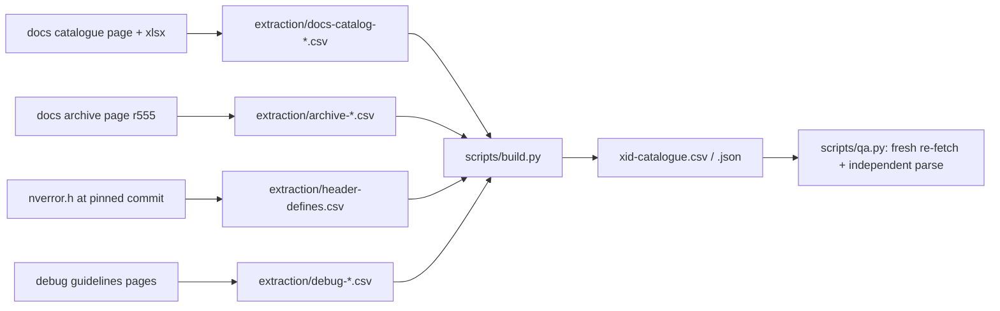

# SOURCES — xid-catalogue v1

Retrieval date: 2026-11-18 (first fetch 2026-11-18T22:21:32Z; verification re-fetches 2026-11-18T22:31:10Z and 2026-11-19T06:29:52Z UTC, each byte-identical to the first fetch). All fetches returned HTTP 200 and were saved unmodified under `raw/`.

| Key | Source | URL | What was taken |
|---|---|---|---|
| S1 | NVIDIA XID Errors, "Analyzing Xid Errors with the Xid Catalog" (page shows "Last updated on Nov 11, 2026") | https://docs.nvidia.com/deploy/xid-errors/analyzing-xid-catalog.html (anchor #id1 = Table 1) | Table 1: code, mnemonic, description, applies-to A100/H100/B100/GB200, immediate and investigatory bucket, Xid 154 linkage; trigger-condition text (summarised only). Tables 2-4 (Xid 144-150 decode, resolution buckets, customer user guide) read for the rules; Table 3 bucket meanings used in CLASSIFICATION.md. Same data downloaded as https://docs.nvidia.com/deploy/xid-errors/_downloads/4586dadb59119a55d1e93a181caa4272/Xid-Catalog.xlsx and used as a cross-check only |
| S1 root | https://docs.nvidia.com/deploy/xid-errors/index.html and sub-pages introduction.html, working-with-xid-errors.html, Notices.html | | index, working-with-xid-errors and Notices read for context and terms; introduction.html read for its SXid statement (SXids are documented in the Fabric Manager User Guide; the page notes that SXid messages apply only to Hopper and earlier generation GPUs). No code rows on these pages. |
| S1b | NVIDIA XID Errors r555 archive page (older GPUs) | https://docs.nvidia.com/deploy/xid-errors/archive/index.html (section #xid-error-listing) | Failure-cause table: failure label per Xid and the seven cause columns. Section 1.2 states SXids are documented in the Fabric Manager User Guide. |
| S2 | nverror.h, open-gpu-kernel-modules | https://github.com/NVIDIA/open-gpu-kernel-modules/blob/main/src/common/sdk/nvidia/inc/nverror.h ; pinned to commit e6a2e01579fbbd1ca2ed43fef2ee2589e9bd8bd9 (committer date 2026-11-05T00:16:53Z, commit message "620.70.06", read from the GitHub commits API). Raw file at that commit is byte-identical to the file fetched from main. | Macro name and value for each code, with line number (#L<n> permalinks in `source_pointers`). |
| S3 | NVIDIA GPU Debug Guidelines | https://docs.nvidia.com/deploy/gpu-debug-guidelines/index.html ; code table at .../gpu-node-triage.html (Table 1 "Common XID Messages and Recommended Steps"); overview, initial-incident-report, best-practices fetched and scanned for Xid/SXID/RMA mentions and tables (no code tables found); Notices read | Per-code action for 14 codes (summarised). Mentions of RMA criteria and SXIDs noted. |

## Licence and terms notes
- **NVIDIA documentation (S1, S1b, S3).** Pages show "Copyright © 2013-2026, NVIDIA Corporation & affiliates. All rights reserved." The Notices page (read on both doc sets) says reproduction of information in the document is permissible only if approved in advance by NVIDIA in writing, reproduced without alteration, and with all associated conditions, limitations and notices; it also says no licence is granted under NVIDIA copyright. **This is a rights risk for a public release of docs-derived content.** The dataset limits itself to factual fields (numbers, identifiers, short labels, applicability flags) and own-words summaries. No permission has been sought or given, and the dataset is not endorsed by NVIDIA. The release states this in its rights note (README.md and the paper).
- **Header (S2).** The file begins with a permission notice in MIT form (read in the file); the repository's COPYING states that, except where noted, individual files are licensed MIT (first lines read, commit e6a2e01579fb). The notice requires the copyright and permission text to be kept with copies or substantial portions; the dataset copies only names and numbers, and should still cite the file and carry the notice in its README.
- **Do not deposit** `raw/`, `extraction/` or `qa-live/`: they hold unmodified NVIDIA pages and files.

## Fields that carry source wording (current state)
- `docs_description`, `archive_failure_label`: the source's short label, verbatim, when it is at most 8 words (longest kept: 8 words). Source labels longer than that are not copied: codes 45, 54, 166, 171, 172 hold an own-words label, set in `scripts/build.py` (`LABEL_REWRITE`) and flagged in `notes`.
- `name_docs`, `name_header`, `docs_immediate_bucket`, `docs_investigatory_bucket`, `docs_xid154_linkage`, applies-to flags: identifiers and short strings as given. A few investigatory values are short phrases (for example "N/A Informational only regarding another Xid").
- `meaning`: for the 77 rows without explanatory text it restates the short label ("Catalogue label: ..."). For codes 13, 14, 31, 32, 43, 45, 48, 54, 63, 64, 74, 79, 93, 94, 95, 110, 119, 120, 121, 137, 140, 154, 155, 157, 159, 163, 164, 165, 166, 168, 170, 171, 172 it is an own-words summary of a narrow factual statement.
- `debug_guideline_action` and `recovery_detail`: own-words summaries of procedural text.
- Trigger-condition text, Table 3 workflow text and Table 4 text are not copied into any field.
- The dataset still reproduces, as facts, most cells of docs Table 1 for 172 codes (mnemonic, flags, buckets, linkage, short label). Whether that needs NVIDIA's approval under the Notices wording is not settled here; the release carries a rights note (README.md).
